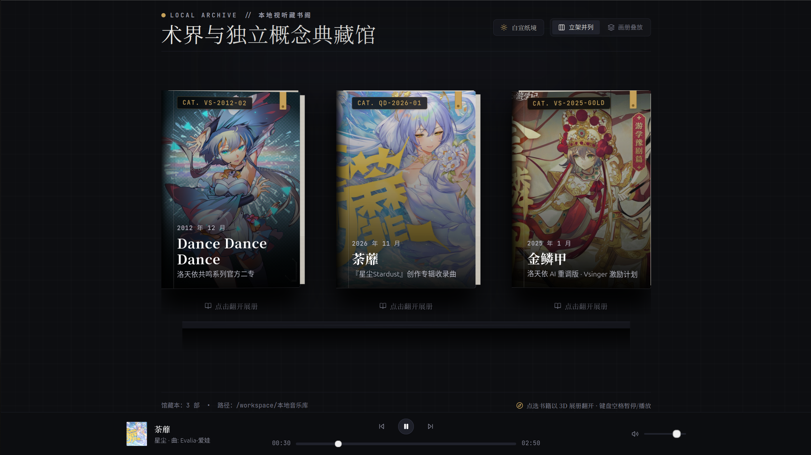
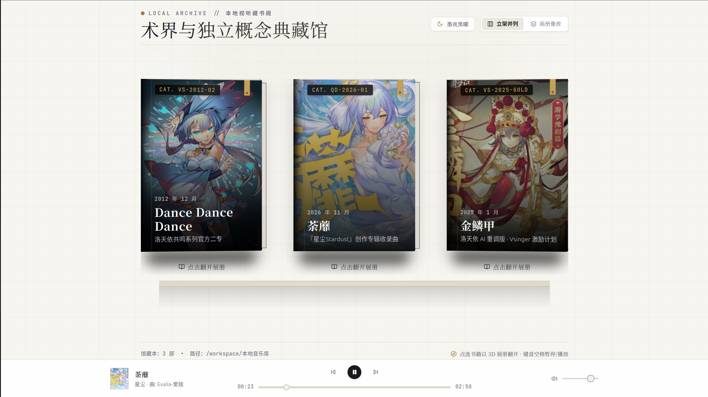

# arc-music-vault (本地视听藏书阁)

一个面向小众、冷门及珍藏数字音乐的离线视听归档与展览程序。

本项目最初的设想，是拒绝流媒体平台千篇一律的卡片堆砌、刺眼霓虹与过度复杂的后台感界面。我们希望把音乐、高清立绘曲绘与原版影像当成真正的艺术品、书籍与历史档案来收纳展示，注重留白，呈现类似实体画册与艺术展馆的厚重感与克制感。

---

## 当前状态：开发中

本项目目前处于早期活跃开发阶段，界面视觉、3D 物理交互与基础视听功能已初步就绪。

### 界面实机预览

| 墨夜黑曜（暗黑模式展架） |
| :---: |
|  |

| 白宣纸境（明亮模式展架） |
| :---: |
|  |

### 开发进度概览

- **已完成功能**：
  - [x] 纯 3D 物理交互体系（移除传统侧边栏，全由精装书籍物理开合流转）
  - [x] 书架陈列双模式（「立架并列」与「画册叠放」平滑切换）
  - [x] 3D 实体精装书建模（布纹凹槽压痕、纸页厚度纹理、真丝书签缎带、鼠标动态反光与接触阴影）
  - [x] 双联艺术展册系统（左右两页开卷动效、中缝装订线、单屏满幅排版适配）
  - [x] 播放细节动效（黑胶唱片滑出旋转、动态音频律动柱、音轨指示线）
  - [x] 全屏纯享艺术展台（装裱画心高清放大与官方高清原版 PV 切换）
  - [x] 黑白双色质感切换（墨夜黑曜与白宣纸境无缝切换）
  - [x] 极简常驻音频播放器与原生音频流直接解析播放
  - [x] 本地离线优先归档规范（按文件夹归档音频分轨、高清原画与视频影像）

- **开发中 / 后续计划**：
  - [ ] 更多藏品文件夹的批量解析与自动扫描导入（减少手动注册配置）
  - [ ] 歌词同步滚动与原曲背景故事长文排版支持
  - [ ] 展册翻页动效扩展与键盘快捷导航增强
  - [ ] 跨平台桌面端与移动端封装（Tauri v2 架构适配）

---

## 设计理念与交互特性

### 1. 纯粹的 3D 物理交互（无后台侧边栏）
彻底砍掉了传统的左侧管理菜单栏，界面的所有层级流转全部依靠 3D 空间内的物理操作驱动：
- **典藏书架**：支持「立架并列」与「画册叠放」两种展陈方式。书本具备真实精装书脊压痕、纸页厚度纹理与悬垂真丝缎带，光影与视角随鼠标平滑倾斜。
- **翻开展册**：点击书籍后触发平滑抬升与开卷动效，以中缝装订线为轴向两侧展开为左右两页平铺的双联展册。
- **纯享展台**：点击原画装裱画心或右上角展台按钮，可进入美术展台细览大图。有原版 PV 的藏品可以在展台播放视频，返回展册或书架后仍会作为背景同步播放。可用底部播放器的「PV 背景」按钮开关。
- **物理回退**：点击返回按钮或按下键盘 `Esc` 键，即可平滑合上书本返回书架。

### 2. 播放状态与细节动效
- **黑胶唱盘滑出**：音乐播放时，左侧画幅背后会平滑滑出一张具有微凹声槽反射与专属盘标的黑胶唱片，并随播放匀速旋转，暂停时停止。
- **声波律动与音轨状态**：当前播放的分轨标题旁伴有跳动的音频律动柱，选中曲目具备专属标记线。
- **单屏完整呈现**：画册展开页与曲目排版经过等比适配，所有版次信息与音轨完整收纳在一屏之内，无需上下滚动页面。

### 3. 黑白双色质感切换
顶部提供「黑白切换」按钮，支持两套低饱和质感界面：
- **墨夜黑曜**：深灰宣纸墨韵底纹，搭配暗金色系与书脊布纹质感。
- **白宣纸境**：手工白宣纸质感底衬，搭配深沉水墨文字与古雅琥珀棕。

---

## 技术实现

### 技术栈
- 基础框架：React 18
- 开发与构建：Vite 5
- 类型系统：TypeScript
- 样式系统：Tailwind CSS
- 动效与物理插值：Framer Motion
- 图标库：Lucide React

### 项目目录结构

```
arc-music-vault/
├── docs/
│   └── screenshots/             # 实机预览截图
├── public/
│   └── albums/                  # 音频、原画与视频资源目录（可使用软链接映射本地音乐库）
├── src/
│   ├── components/
│   │   ├── BookshelfView.tsx    # 3D 典藏书架视图（支持立架与画册叠放）
│   │   ├── ThreeDimensionalBook.tsx # 3D 实体精装书模型与光泽交互
│   │   ├── BookSpreadView.tsx   # 双联画册展开页（曲目列表、黑胶唱盘与制作印记）
│   │   ├── GalleryStageView.tsx # 全屏艺术展台（原画细览与官方 PV 播放）
│   │   └── QuietPlayer.tsx      # 底部常驻极简播放器
│   ├── data/
│   │   └── vaultData.ts         # 藏品元数据结构与曲目配置
│   ├── types.ts                 # TypeScript 接口定义
│   ├── index.css                # 宣纸底纹与物理投影样式
│   ├── App.tsx                  # 状态管理与主视图流转
│   └── main.tsx                 # 入口文件
├── package.json
└── vite.config.ts
```

---

## 本地运行

### 1. 安装依赖

```bash
npm install
```

### 2. 启动本地开发服务

```bash
npm run dev
```

默认开发服务运行于 `http://localhost:5173/`。

### 3. 构建生产版本

```bash
npm run build
```

---

## 音乐库组织与归档规范

系统采用本地离线优先的收录原则，一个文件夹收录一首歌曲或一张专辑。建议的本地文件夹组织形式如下：

```
本地音乐库/
├── 专辑名或曲目名/
│   ├── cover.jpg               # 高清原画或封面图（支持竖版与横版构图）
│   ├── 01. 曲目名.m4a           # 原始音频分轨（建议无损或原码流 AAC/FLAC）
│   ├── 02. 曲目名.m4a
│   ├── 原版PV.mp4              # 官方高清视频影像（可选）
│   ├── metadata.json           # 专辑元数据（创作者、发行节点、风格等）
│   └── README.md               # 历史背景与归档说明
```

将该文件夹放置或通过软链接映射至 `public/albums/<folder_name>`，并在 `src/data/vaultData.ts` 中配置对应曲目与路径，即可自动载入展册与播放器。

---

## 快捷键

- `空格键 (Space)`：暂停 / 继续播放
- `Esc`：从全屏展台返回双联画册，或从双联画册返回书架
